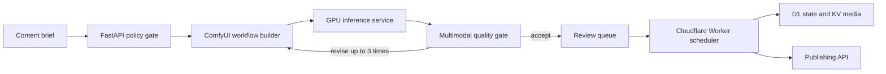

# AI Character Content Platform

A portfolio-safe reference implementation of an end-to-end system for generating, reviewing, scheduling, and publishing content for fully synthetic fictional characters.

The production project uses private character assets, model weights, credentials, and platform accounts. Those materials are intentionally excluded. This repository preserves the engineering architecture, safety controls, failure handling, and representative tests without publishing private data.

## What this demonstrates

- FastAPI service that validates requests and submits parameterized workflows to ComfyUI
- LoRA-aware workflow construction with deterministic seeds and configurable strengths
- Quality-gate orchestration for accept, targeted revision, and manual-review outcomes
- Privacy-preserving audit events that hash prompts instead of storing raw text
- Cloudflare Worker scheduling with D1-backed atomic claims and retry-aware state transitions
- OAuth token encryption with AES-GCM and PKCE-oriented helper functions
- Automated tests for policy, workflow mutation, quality decisions, audit behavior, scheduling, and authentication

## Architecture



See [docs/architecture.md](docs/architecture.md) for the component and failure-state design.

## Evaluation snapshot

The private implementation used the following reproducible experiment design. Training assets and generated images are not included.

| Item | Value |
|---|---:|
| Captioned training images | 48 |
| Weighted samples | 208 |
| LoRA rank / alpha | 32 / 16 |
| Training steps | 1,600 |
| Evaluation outputs | 160 |
| Automated tests in this repository | 20 |

The 160-output evaluation varied seeds, LoRA strengths, expressions, and scenes. The goal was not to publish a subjective quality score, but to create a consistent review surface for identity stability, prompt adherence, and artifact detection.

## Repository structure

```text
app/                  FastAPI, policy, workflow, quality, and audit modules
tests/                14 Python unit tests
worker/               Cloudflare Worker publisher and 6 Node tests
docs/                 Architecture, evaluation, and security notes
examples/             Provider-neutral ComfyUI workflow template
```

## Run the API

```bash
python -m venv .venv
source .venv/bin/activate
pip install -e '.[dev]'
cp .env.example .env
uvicorn app.main:app --reload
```

ComfyUI should be reachable only through a private network. The example workflow is deliberately model-neutral; replace its placeholder node values with models you are licensed to use.

## Run tests

```bash
python -m unittest discover -s tests -v
cd worker && npm test
```

## Safety and privacy

- Only fully synthetic fictional characters are supported.
- Requests involving minors, real-person impersonation, face swaps, or public figures are rejected.
- Raw prompts and generated media are excluded from audit logs by default.
- Secrets, OAuth tokens, model weights, private datasets, generated outputs, local logs, and deployment identifiers are excluded from the repository.
- Production use still requires platform-policy review, content provenance, access controls, human review, and a deletion/reporting process.

## License

MIT. Model weights, training data, and generated media are not distributed under this license.
